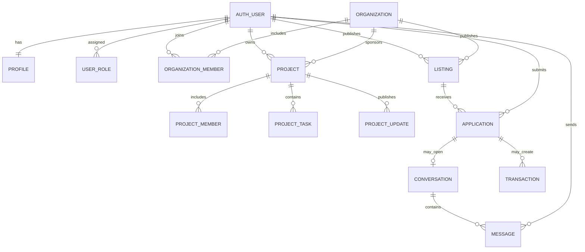

# IDEA LAB — yagona ma'lumotlar arxitekturasi

Versiya: 1.0 — loyiha taklifi  
Sana: 2026-11-15  
Repository: `msodiq01/idea-lab`  
Holat: hujjatlashtirilgan loyiha modeli; hali backendga qo'llanmagan.

## 1. Arxitektura maqsadi

IDEA LAB barcha modullarni bitta izchil modelga birlashtiradi. Har bir ma'lumotning:
- yagona ID raqami;
- egasi yoki mas'ul tashkiloti;
- aniq turi va holati;
- yaratilgan va yangilangan vaqti;
- ko'rish va boshqarish ruxsatlari;
- kerak bo'lsa, bog'langan loyiha, e'lon yoki arizasi bo'ladi.

Frontend sahifalari mustaqil ma'lumot ombori bo'lmaydi. Ular yagona ma'lumot qatlamining turli ko'rinishlari bo'ladi.

## 2. Asosiy obyektlar

### A. Account va Profile

- `auth.users` — autentifikatsiya identifikatori; login va sessiya.
- `profiles` — foydalanuvchining umumiy profili: ism, avatar, til, vaqt mintaqasi va ochiq bio.
- `profile_contacts` (taklif) — telefon, email va boshqa maxfiy aloqa ma'lumotlari; egasi va ruxsat berilgan tomonlargagina ko'rinadi.
- `user_roles` (taklif) — tasdiqlangan rollar. Oddiy foydalanuvchi o'ziga admin yoki moderator rolini bera olmaydi.

Bir odamga bir nechta rol berilishi mumkin, lekin rolni belgilash faqat ishonchli server/admin jarayoni orqali amalga oshadi.

### B. Organization

Tashkilot, kompaniya, ta'lim muassasasi, jamoa yoki boshqa yuridik/ijtimoiy birlikni ifodalaydi.

Taklif etiladigan maydonlar: `id`, `name`, `organization_type`, `description`, `website`, `public_location`, `owner_id`, `verification_status`, `created_at`, `updated_at`.

A'zolik alohida `organization_members` jadvalida: `organization_id`, `user_id`, `member_role`, `membership_status`, `invited_by`.

### C. Project

Loyiha — asosiy ish birligi. Egasi shaxs yoki tashkilot bo'lishi mumkin. Loyiha jamoa, vazifa, yangilik, resurs va arizalarga bog'lanadi.

Asosiy maydonlar: `id`, `owner_user_id` yoki `owner_organization_id`, `name`, `slug`, `direction`, `description`, `visibility`, `status`, `funding_goal`, `currency`, `created_at`, `updated_at`.

### D. Listing — barcha e'lonlar uchun yagona tushuncha

Listing katalogga chiqariladigan taklif yoki imkoniyatdir. Turi:
- `job` — vakansiya;
- `need` — talab;
- `offer` — taklif;
- `product` — mahsulot;
- `service` — xizmat;
- `resource` — uskuna, xomashyo yoki resurs;
- `property` — ko'chmas mulk;
- `event` — tadbir.

Har bir listingda `id`, `owner_id`, `organization_id` (ixtiyoriy), `type`, `title`, `description`, `category_id`, `location`, `visibility`, `status`, `published_at`, `expires_at`, `created_at`, `updated_at` bo'ladi.

Turga xos qo'shimcha maydonlar `listing_details` yoki aniq tur jadvallarida saqlanadi. Maxfiy telefon/email umumiy listing jadvaliga yozilmaydi.

### E. Application — barcha murojaatlar uchun yagona jarayon

Application — foydalanuvchining loyiha, ish, jamoa, taklif, resurs yoki tadbirga yuborgan rasmiy murojaati.

Umumiy maydonlar: `id`, `target_type`, `target_id`, `applicant_user_id`, `message`, `status`, `created_at`, `updated_at`, `reviewed_by`, `reviewed_at`.

Dastlab mavjud maxsus jadvallarni birdaniga yo'q qilish shart emas. Ular aniq modelga moslashtirilib, API/UI bir xil status va ruxsat qoidalariga o'tkaziladi. Polimorf `target_id` uchun ma'lumotlar yaxlitligi alohida trigger yoki turga xos FK bilan ta'minlanishi kerak; faqat matnli IDga ishonilmaydi.

### F. Conversation va Message

Suhbat ma'lum bir ariza yoki bitimga bog'lanadi. Faqat ariza ishtirokchilari va vakolatli moderator ko'ra oladi.

- `conversations`: `id`, `application_id`, `created_at`.
- `conversation_participants`: `conversation_id`, `user_id`, `joined_at`.
- `messages`: `id`, `conversation_id`, `sender_id`, `body`, `created_at`, `read_at`.

### G. Transaction — keyingi bosqich

Buyurtma, invoice va to'lov holatlari alohida qatlam bo'ladi. IDEA LAB bank yoki to'lov tashkiloti sifatida ishlamaydi. Pul o'tkazmalari faqat qonuniy litsenziyaga ega bank/to'lov provayderi integratsiyasi orqali amalga oshiriladi. Platformada provayder tranzaksiya identifikatori, summa, valyuta va holat qayd etilishi mumkin; maxfiy karta ma'lumotlari saqlanmaydi.

### H. AuditLog

Muhim amallar: e'lonni chop etish/yashirish, ariza holatini o'zgartirish, rol berish, tashkilot tasdiqlash, loyiha a'zoligini o'zgartirish. Logda actor, action, target, timestamp va xavfsiz metadata saqlanadi; parol/token kabi sirlar hech qachon yozilmaydi.

## 3. Bog'lanishlar xaritasi

Bu diagramma maqsadli modelni ko'rsatadi; u hozirgi SQL sxemasining to'g'ridan-to'g'ri nusxasi emas.

## 4. Joriy Supabase jadvallarini yangi modelga xaritalash

| Hozirgi jadval | Maqsadli obyekt | Qaror |
|---|---|---|
| `profiles` | Profile | Saqlash; role maydonini foydalanuvchi o'zgartira olmaydigan qilish |
| `projects` | Project | Saqlash; egani user yoki organization bilan standartlash |
| `teams` | Organization / ProjectMember | Jamoa mustaqil tashkilotmi yoki loyiha guruhi ekanini belgilash; dublikat a'zolikni oldini olish |
| `job_posts` | Listing(type=job) | Keyingi migratsiyada Listing modeliga o'tkazish |
| `specialist_profiles` | Profile extension | Mutaxassis ma'lumotini profilga bog'lash; resume faylini private storage'da saqlash |
| `offers` | Listing(type=offer) | Listing modeliga o'tkazish |
| `investors` | Organization yoki investor profile extension | Investor shaxsmi/tashkilotmi — aniq ajratish |
| `resources` | Listing(type=resource/product/service) | Tur va narx/valyutani standartlash |
| `project_investment_applications` | Application(type=investment) | Ariza egasi va loyiha egasining ruxsatlarini ajratish |
| `team_applications` | Application(type=team_join) | Application oqimiga moslash |
| `job_applications` | Application(type=job) | Application oqimiga moslash |
| `offer_applications` | Application(type=offer) | Application oqimiga moslash |
| `offer_messages` | Conversation / Message | Ishtirokchilar asosida ruxsat berish |
| `resource_orders` | Application yoki Order | Buyurtma va murojaatni biznes qoidasi bo'yicha ajratish |
| `project_members` | ProjectMember | Saqlash; rol va taklif/qabul holatini kengaytirish |
| `project_tasks` | ProjectTask | Saqlash; assignee va loyiha egasi ruxsatlarini mustahkamlash |
| `project_updates` | ProjectUpdate | Saqlash |
| `events` | Listing(type=event) yoki Event | Tadbir uchun maxsus ro'yxatdan o'tish qoidalari bo'lsa alohida Event qolishi mumkin |
| `event_registrations` | Application(type=event_registration) | Sig'im va ro'yxatdan o'tish holatini tekshirish |

## 5. Yagona status lug'ati

Status qiymatlari ma'lumotlar bazasida barqaror inglizcha machine value, interfeysda o'zbekcha tarjima sifatida ko'rsatiladi.

| Obyekt | Ruxsat etilgan qiymatlar | UI tarjimasi |
|---|---|---|
| Listing | `draft`, `pending_review`, `active`, `paused`, `closed`, `rejected`, `archived` | Qoralama, Tekshiruvda, Faol, To'xtatilgan, Yopilgan, Rad etilgan, Arxiv |
| Application | `submitted`, `reviewing`, `interview`, `accepted`, `rejected`, `withdrawn` | Yuborildi, Ko'rib chiqilmoqda, Suhbat, Qabul qilindi, Rad etildi, Bekor qilindi |
| Organization | `unverified`, `pending`, `verified`, `suspended` | Tasdiqlanmagan, Tekshiruvda, Tasdiqlangan, Cheklangan |
| Project | `draft`, `active`, `paused`, `completed`, `cancelled`, `archived` | Qoralama, Faol, To'xtatilgan, Yakunlangan, Bekor qilingan, Arxiv |
| Membership | `invited`, `pending`, `active`, `declined`, `removed` | Taklif etilgan, Kutilmoqda, Faol, Rad etilgan, Chiqarilgan |

Status o'tishlari serverda tekshiriladi. Masalan, foydalanuvchi o'z arizasini `accepted` holatiga o'zi o'tkaza olmaydi; buni faqat tegishli e'lon egasi yoki vakolatli xodim amalga oshiradi.

## 6. Ma'lumot sifati va standartlar

1. Asosiy ID — UUID; eski localStorage ID qiymatlari faqat migratsiya xaritasi sifatida `legacy_id`da vaqtincha saqlanadi.
2. Har bir biznes obyektida `created_at` va `updated_at` UTC timestamptz bo'ladi.
3. Pul qiymati floating-point emas, numeric/decimal; har bir summada ISO 4217 valyuta kodi bo'ladi.
4. Telefon va email normallashtiriladi, lekin ommaviy katalogda oshkor qilinmaydi.
5. Foydalanuvchi kiritgan HTML matn sifatida ko'rsatiladi; UI'da xavfsiz escape qilinadi.
6. O'chirish siyosati belgilanadi: e'lonlar arxivlanadi; hisob va shaxsiy ma'lumotlarni o'chirish talablari alohida jarayon.
7. Har bir jadvalda egasi, public/private darajasi va RLS test holatlari hujjatlashtiriladi.
8. Barcha ro'yxatlarda pagination, server-side qidiruv va aniq tartiblash qoidasiga o'tiladi; butun katalogni birdan yuklashdan qochiladi.

## 7. Ruxsat darajalari

- **Public:** e'lonning ommaga chiqarishga ruxsat etilgan maydonlari.
- **Authenticated:** tizimga kirgan foydalanuvchining umumiy katalog va shaxsiy funksiyalari.
- **Owner:** faqat o'z e'loni/loyihasi/tashkilotini boshqarish.
- **Participant:** o'zi a'zo bo'lgan loyiha yoki ariza suhbatini ko'rish.
- **Moderator:** faqat aniq vakolat va audit log bilan moderatsiya.
- **Service/admin:** server tomondagi maxsus operatsiyalar; maxfiy kalit brauzerga berilmaydi.

RLS jadval darajasida, ustun maxfiyligi esa alohida ko'rinish/jadval/grant orqali himoyalanadi. RLS yoqilganining o'zi maxfiy ustunlar xavfsizligini kafolatlamaydi.

## 8. Frontend modul xaritasi

| UI sahifa | Ko'rsatadigan obyektlar | Asosiy amallar |
|---|---|---|
| Bosh sahifa | Ochiq loyiha va listinglar | Qidirish, loyiha yaratishni boshlash |
| Dashboard | Profil, loyihalar, arizalar, vazifalar | Shaxsiy ishlarni boshqarish |
| Loyihalar | Project | Yaratish, tahrirlash, tafsilot |
| Loyiha tafsiloti | Project, ProjectMember, ProjectTask, Application | A'zo qo'shish, investitsiya arizasi, yangilik |
| Investorlar | Investor profile, investment Application | Katalog, ariza ko'rish va status |
| Jamoalar | Organization/Team, Membership, job Listing, Application | Jamoaga qo'shilish, vakansiya va ariza |
| Mutaxassislar | Profile extension | Mutaxassis qidirish, profil ko'rish |
| Takliflar | Listing, Application, Conversation | Taklif, murojaat, xabar |
| Global bozor | Product/Service/Resource listing, Order | Katalog, keyingi bosqichda buyurtma |
| Talab & Taklif | Need/Offer listing | E'lon yaratish, moslik topish |
| Shaxsiy kabinet | Profile, owner dashboard | Profil va maxfiylik sozlamalari |

## 9. Migratsiya strategiyasi — backendga ulashdan oldin

1. Ushbu modelni mahsulot qoidalari bo'yicha tasdiqlash.
2. Joriy localStorage maydonlarini field-by-field mapping jadvaliga kiritish.
3. Har bir eski yozuvga yangi UUID yaratish va `legacy_id` bilan bog'lash.
4. Dublikatlar, egasiz yozuvlar, noto'g'ri statuslar va yetishmayotgan majburiy maydonlarni hisobot qilish.
5. Faqat test Supabase loyihasida schema/migration sinovi.
6. RLS test matritsasi: anonim, foydalanuvchi A, foydalanuvchi B, e'lon egasi, loyiha a'zosi, moderator.
7. Frontendni modulma-modul backendga ulash; har modul uchun rollback rejasi.
8. Eski localStorage yozuvlarini faqat foydalanuvchi roziligi va import tekshiruvidan keyin ko'chirish.

## 10. Keyingi aniq ishlab chiqish vazifalari

- [ ] `jobs.html` noto'g'ri havolasini `teams.html#career-section` bilan almashtirish.
- [ ] `investorRequests` va `investmentApplications` farqini mahsulot qoidasi bilan aniqlash.
- [ ] `ideaLabExchangeItems` uchun Listing(type=need/offer) modeliga mos mapping tuzish.
- [ ] `ideaLabCurrentUser`ni olib tashlash rejasini tayyorlash; yagona auth profiliga o'tish.
- [ ] UI status qiymatlarini bitta markaziy lug'atga yig'ish.
- [ ] README'ni o'rnatish, sahifalar xaritasi, demo cheklovlari va test tartibi bilan to'ldirish.
- [ ] Schema va RLS uchun alohida test loyihada avtomatlashtirilgan tekshiruvlar tayyorlash.

## 11. O'zgartirilmagan narsalar

Bu hujjat arxitektura taklifidir. SQL schema, migration, HTML, CSS, JavaScript yoki Supabase loyihasi o'zgartirilmadi. Hozircha real foydalanuvchi akkauntlari, server ma'lumotlari yoki to'lovlar mavjud deb hisoblanmaydi.

## 11. Yagona Account/Profile/Organization qarori

Batafsil talablar `IDENTITY-MODEL.md` hujjatida. Asosiy qarorlar:
- Account va Profile 1:1; autentifikatsiya ma'lumotlari profildan alohida.
- Profil faoliyat yo'nalishlari xavfsizlik rollari emas.
- OrganizationMembership va ProjectMembership alohida; birining a'zoligi ikkinchisiga avtomatik o'tmaydi.
- Project egasi shaxs yoki tashkilot bo'ladi, ikkalasi bir vaqtda emas.
- SpecialistProfile — Profile kengaytmasi.
- Email orqali egalikni aniqlash vaqtinchalik demo usuli; kelajakda barqaror account ID ishlatiladi.
- Tashkilot vakilligi va investor maqomi faqat checkbox bilan tasdiqlanmaydi.

Bu qarorlar maqsadli modeldir; SQL yoki frontendga qo'llanmagan.
