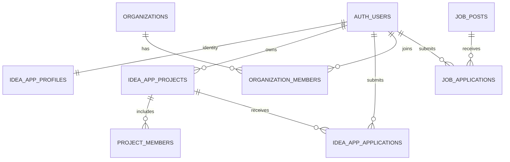

# IDEA LAB — Hybrid Innovation design and live data map

Version: 1.0
Branch: design/hybrid-system-foundation

## Visual direction

Hybrid Innovation combines a premium graphite/violet application shell with calm, readable light work surfaces.

| Token | Value | Use |
|---|---|---|
| Graphite | #11101b | Global navigation and premium headers |
| Deep violet | #1b1930 | Header gradients and hero surfaces |
| Violet | #7865f5 | Primary actions and active navigation |
| Cyan | #16b8c2 | Secondary accent and data highlights |
| Canvas | #f4f6fb | Main workspace background |
| Surface | #ffffff | Cards, forms and tables |
| Table header | #f3f2fb | Table column headings |
| Table border | #e7e7f0 | Separators and table outlines |

## Component rules

- Keep the global navigation dark, high-contrast and consistent on every module.
- Keep dense working areas light for readability and long sessions.
- Use violet for primary actions; cyan is a secondary accent, not a second competing primary.
- Tables use a clear header row, sticky column header where appropriate, horizontal scrolling on narrow screens, and visible row separators.
- Status labels must be text-bearing pills, not color alone.
- Inputs need visible labels, focus states and validation feedback.
- Respect `prefers-reduced-motion`; do not make animation essential to understanding.
- Do not change business logic, permissions, or persisted data as part of a visual-only change.

## Live database boundary

The current production Supabase project is active. The existing schema already contains legacy public tables and the newer `idea_app` schema. The repository's `DATA-ARCHITECTURE.md` is a target design proposal, not a statement that every proposed object exists in production.

Confirmed by the connected project inspection:
- `public.profiles`, `public.projects`, `public.teams`, `public.job_posts`, `public.specialist_profiles`, `public.offers`, `public.investors`, `public.resources`, `public.audit_logs` and related legacy tables exist.
- `idea_app.profiles`, `idea_app.projects`, `idea_app.applications`, `idea_app.specialist_profiles` and related private application tables exist.
- Existing RLS and SECURITY INVOKER views/RPCs must be preserved. A UI change must never weaken database authorization.
- Current inspection showed zero rows in key account/application tables. Therefore two-user isolation and end-to-end account tests remain open; do not interpret empty tables as proof that policies are correct.

## Relationship overview (conceptual)

This is a conceptual relationship map based on repository contracts and migration names. It is not a generated ER diagram of every production constraint. Verify exact foreign keys and RLS before any schema change.

## Safe implementation sequence

1. Apply and review the visual token layer (this branch).
2. Validate all existing pages and mobile breakpoints with the repository test suite.
3. Inventory each module's source of truth and classify it as server-backed, partial, or local demo.
4. Run the Auth/project/application flow with two dedicated test accounts; do not use real user credentials.
5. Prioritize partially server-backed applications and specialist profile flows.
6. Migrate local/demo modules only after their ownership, access policy, validation and rollback plan are documented.
7. Add analytics and error monitoring after privacy and event collection rules are reviewed.

## Change boundary

This design layer is additive. It does not create, drop, rename, or migrate database tables; it does not change RLS policies, roles, Auth settings, storage permissions, or user records.
